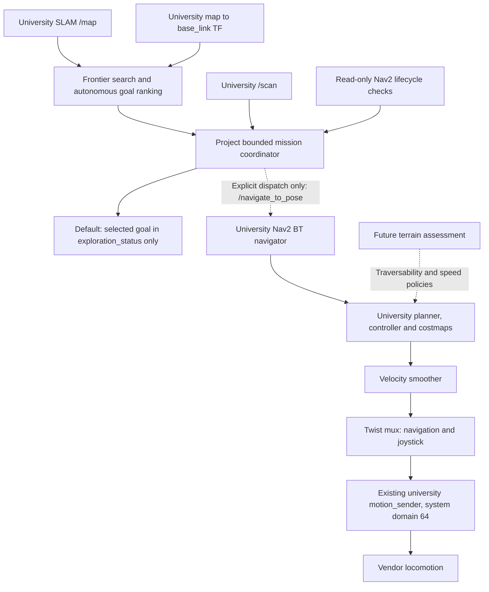

# Exploration using the university navigation stack

## Ownership and interfaces

The project owns frontier selection, autonomous destinations and mission
supervision. The university owns SLAM/localization, odometry/TF, obstacle
costmaps, navigation planning/control, velocity smoothing/arbitration and the
existing robot bridge. The project launches just one coordinator. Preview and
mission CLI are optional tools; neither is a second navigation stack.

Source verification: university `lite3.launch.py` includes base, joystick, mux
and navigation. Navigation defaults to an empty namespace and composed Nav2,
including `bt_navigator`, `controller_server`, `planner_server`, smoother,
behaviors and waypoint follower. It uses Navfn and MPPI, rather than the
project's earlier Navfn/Regulated Pure Pursuit setup. The university planner
allows unknown cells; frontier selection still chooses known-free goals. Its
costmaps and BT decide actual paths/recoveries. The coordinator sets no custom
BT, so university recovery behavior remains in effect on explicit dispatch.

| Interface | Binding and use |
| --- | --- |
| Occupancy map | `/map`, `nav_msgs/msg/OccupancyGrid`, reliable/transient-local, `map` frame |
| Robot pose | TF `map -> base_link`, finite x/y and fresh stamp |
| Scan | `/scan`, `sensor_msgs/msg/LaserScan`, sensor-data QoS, `base_link` |
| Navigation | `/navigate_to_pose`, `nav2_msgs/action/NavigateToPose` |
| Lifecycle | `/{controller_server,planner_server,bt_navigator}/get_state`, read-only |
| Mission control | `/lite3_locomotion/start_exploration` and `stop_exploration`, `std_srvs/srv/Trigger` |
| Status | `/lite3_locomotion/exploration_status`, JSON in `std_msgs/msg/String` |

`--nav2-namespace /example` prefixes the action and lifecycle services only.
Map, scan and TF remain the inspected root bindings; arbitrary multi-robot frame
remapping is outside this configuration. ROS remapping arguments are rejected.
The CLI starts/stops the mission and never arms a motion sender or changes modes.

## Development behavior and safety

The launch accepts `output_mode:=dry-run` only. It runs the coordinator with
navigation disabled and starts no Nav2, lifecycle manager or motion adapter.
Preview has no action client and sends no goals. Status reports `navigation_enabled`,
`selected_goal`, `running`, `reason`, `goals_sent`, `nav2_active` and
`pending_termination`. Preview can use an existing map without Nav2 being active.

Explicit `--enable-navigation` on the coordinator selects the existing action
client. It can move the robot through Nav2; it is not used on the live domain
in development. It requires all three navigation lifecycle nodes active with
fresh replies and a ready action server. No lifecycle transitions are requested.

Retained and consolidated checks:

- Explicit start, idle startup, no automatic restart after stop.
- Bounded frontier search, conservative known-free goal clearance and ranking.
- Map validation and receipt freshness of 30 seconds; TF stamp age at most 0.5 s
  with 0.2 s future allowance.
- Scan receipt and header freshness of 0.5 s, roughly full-circle coverage,
  valid beam proportion and 0.4 m obstacle clearance.
- Mission radius 3 m, goal margin 0.4 m, session duration 60 s by default;
  repeated starts do not extend the session or recenter bounds.
- At most 20 goals; 30 s goal deadline; stop after three consecutive failures;
  successful/failed goal cooldowns of 30/60 s.
- Cancellation on loss of inputs, lifecycle readiness or mission bounds.
- Late acceptance after stop is canceled. New starts are rejected while previous
  submissions/results remain unresolved. Cancellation failure or a missing
  terminal result after the 3 s cancellation deadline latches restart disabled.
- Shutdown attempts cancellation and waits up to 3 s while ROS remains available.

These are software supervision and placeholder limits, not validated Lite3
operating limits. Goal radius does not constrain Nav2's entire planned path;
pose monitoring reacts after movement. No physical stop is inferred from a
successful mission stop service response or cancellation acknowledgement.
A terminal action result confirms navigation termination, not measured robot rest.

The former velocity clamp, per-command watchdog and sender-session mechanism
remain in [excluded legacy source](../legacy/README.md) and offline regression
tests, but are **not in the university
command path**. Do not claim their protection for this architecture. The
university mux's expiry does not establish crash-safe braking. Before live
exploration, inspect the deployed bridge and all command inputs, independent
watchdog, link-loss behavior and physical stop controls; decide whether the
university path already enforces the needed velocity/safety limits or needs a
separately reviewed project gate. Do not create another UDP sender to solve
missing visibility. No changes to university packages were made.

## Verification and usage

Use the build, unit-test and isolated integration commands in the
[README](../README.md). The new real-DDS suite uses a mock action server and
synthetic sensors, without navigation/transport processes. It checks root and
namespaced action bindings, disabled output, mission CLI, success/rejection/abort,
cancellation, stale input and deadlines. This verifies the installed action
contract, not performance of the university planner or the physical robot.

The earlier group-domain inspection did not expose Nav2 or a map. Subsequent
read-only inspection of the system computer's domain 64 found `/motion_sender`
subscribing to `/cmd_vel`, `/cmd_vel_corrected`, `/simple_cmd` and `/complex_cmd`,
with live target parameters `192.168.1.120:43893`. No shared service was changed
to obtain this evidence. Runtime forward navigation remains unverified; see
the historical [supervised trial](walking_trial_2026-11-13.md), which produced
stepping in place and an operator-confirmed stop.

The complete [file inventory and dependency audit](code_audit.md) records the
second cleanup. Only the pure scan predicate remains in active
[safety.py](../lite3_locomotion/safety.py); the velocity gate and all custom
transport modules are excluded from installation. The active coordinator never
imports them. The fixed-topic non-actuating controller is retained as an
optional regression harness, not a production motion path.

The isolated integration suite additionally exercises real university Navfn
planning against a synthetic map; it launches no velocity-producing controller.
This verifies planning and client behavior, not full navigation/firmware behavior.

## Terrain traversal

Still required: calibrated LiDAR/IMU assessment of slope, roughness, steps and
drop-offs; terrain uncertainty handling; traversability costs consumed through
supported Nav2 interfaces; route/speed policies and verified gait/capability
interfaces where needed. Evaluate with recorded data and simulation before
physical trials. A 2D occupancy frontier and obstacle scan do not detect safe
footholds or drop-offs. Reuse the vendor locomotion controller; no joint-level
controller has been implemented or justified by this refactor.
