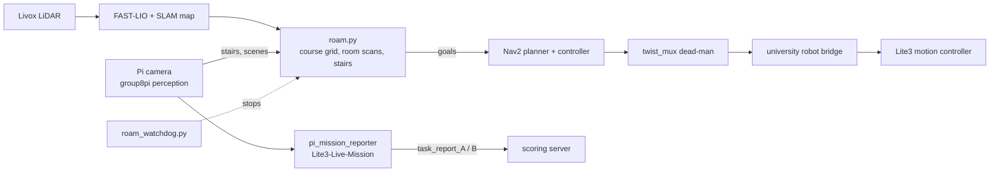

# Lite3 Autonomous Navigation

Autonomous exploration for a Deep Robotics **Lite3** quadruped, built by Group 8 for the
Intelligent Robotics course. The robot walks a disaster-response arena on its own, maps it with
LiDAR SLAM, keeps a 1 × 1 m grid of the course, scans rooms from the doorway, climbs stairs and
crosses obstacles, while a Raspberry Pi camera reports what it sees and a reporter sends the
mission findings (M01–M05) to the scoring server.

ROS 2 Humble, Nav2, FAST-LIO SLAM, Python. The university's existing `lite3_launcher` navigation
stack and robot bridge are reused rather than replaced.

> **Safety:** the handheld remote STOP is the emergency stop. Keep it in hand from the moment you
> type `ARM` until the run is over. None of the software stops in this repo replaces it.

## How it fits together



| Computer | Role |
|---|---|
| NUC `group8` (this repo, `~/lite3_ws`) | Navigation stack, roaming, RViz, command log, mission reporter |
| Pi `group8pi` | Camera perception service `group8pi-perception`: stairs, room-scan scenes |
| Robot system computer | University-managed LiDAR drivers, `motion_sender` / `motion_receiver`, domain bridge |
| Your laptop | [Monitoring dashboard](https://github.com/JaimieSE/Lite3_Monitoring_Dashboard) at `http://127.0.0.1:3000` |

## Repository layout

| Path | What it is |
|---|---|
| `src/lite3_movement_tests/` | **The roaming package.** `roam.py` (session, decisions, CLI), `course_grid.py` (1 m grid memory, corridors vs dead ends), `wall_gaps.py`, `stairs.py`, `scene_hints.py`, `roam_ros.py` / `roam_sim.py` (robot vs simulator), `roam_watchdog.py` (independent watchdog), `plain_terminal.py` (operator output), shared readiness runner and telemetry. Tests in `test/`. |
| `src/lite3_locomotion/` | Navigation launch, Nav2 parameters and behaviour trees, collision profile, terrain monitor, earlier frontier coordinator. |
| `src/lite3_livox_cloud/` | Builds the terrain point cloud from the local Livox scan. |
| `operator/` | Everything an operator runs: `competition_start.sh`, `roam.sh`, `start_navigation.sh`, `stop_navigation.sh`, `command_log.sh`, `status.sh`, `build.sh`, RViz configs and the manuals. |
| `.baseline/` | Copies of removed code (the old M0–M9 physical test suite), kept for reference. |

`src/livox_ros_driver2/` and `src/transfer_interfaces/` are vendor packages that must be present
in the workspace but are not tracked here.

## Getting started

On the NUC:

```bash
cd ~/lite3_ws
source operator/env.sh      # ROS 2 Humble + the university workspace (~/ros2_ws)
operator/build.sh           # after any code change
```

Rehearse without the robot:

```bash
operator/roam.sh start --sim
```

Run the unit tests (no ROS, no robot). Do not run the full suite on the NUC during a physical run.

```bash
python3 -m pytest src/lite3_movement_tests/test
```

## Competition run

The full procedure is in [operator/COMPETITION_MANUAL.md](operator/COMPETITION_MANUAL.md)
(printable: `operator/COMPETITION_STARTING_MANUAL.pdf`). In short:

1. Pi perception active: `ssh group8pi 'systemctl --user is-active group8pi-perception'`.
2. Command logger: `operator/command_log.sh start`.
3. Dashboard live, **Record session** pressed.
4. Robot standing in the start cell, facing the course's +X direction.
5. Start, then type `ARM` and `ROAM` when asked:

   ```bash
   operator/competition_start.sh --physical --arena A    # or --arena B
   ```

6. While it runs: `operator/roam.sh status | pause | resume`.
7. Finish: `operator/competition_start.sh stop`.

Without `--physical`, `competition_start.sh` is a dry run: real sensors, robot still, RViz showing
what roam would do. Run logs and reports go to `log/operator/run-<start>/`.

## Documentation

- [operator/COMPETITION_MANUAL.md](operator/COMPETITION_MANUAL.md): official run, step by step
- [operator/CHEATSHEET.md](operator/CHEATSHEET.md): roaming commands on one page
- [operator/README.md](operator/README.md): detailed operator guide (navigation stack, readiness checks, troubleshooting)
- [operator/COMPETITION_PLAN.md](operator/COMPETITION_PLAN.md): strategy for the course
- [src/lite3_movement_tests/README.md](src/lite3_movement_tests/README.md): roaming package modules
- [src/lite3_locomotion/README.md](src/lite3_locomotion/README.md): navigation and frontier exploration

## Related repositories

- [Lite3-Live-Mission](https://github.com/JaimieSE/Lite3-Live-Mission): Pi mission reporter, scene capture and scoring, nav hold
- [Lite3-Scene-Understanding](https://github.com/JaimieSE/Lite3-Scene-Understanding): camera, YOLO and Claude scene scripts
- [Lite3-Rescue-Mission](https://github.com/JaimieSE/Lite3-Rescue-Mission): `rescue_mission` objective store (ROS 2)
- [Lite3_Monitoring_Dashboard](https://github.com/JaimieSE/Lite3_Monitoring_Dashboard): live web dashboard and bridge
