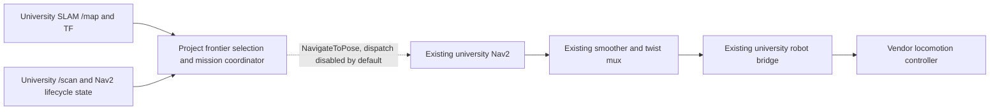

# Lite3 autonomous exploration

This project adds **autonomous frontier selection and bounded mission management**
to the university's existing `lite3_launcher` navigation stack. It reuses the
university SLAM, TF, Nav2 planner/controller, smoother, arbitration and robot
bridge. It does not launch a second navigation stack or UDP motion sender.

The development launch starts **one coordinator with navigation output disabled**.
It can select and report destinations from an existing map without sending them
to Nav2. It starts idle; mission start is explicit. No robot service or control
mode is changed. There is no velocity or posture-command publisher in the active
coordinator.



The source-verified default action is `/navigate_to_pose`, type
`nav2_msgs/action/NavigateToPose`; the coordinator supports an explicit Nav2
namespace. Read-only system-domain-64 inspection confirms the existing
`/motion_sender` and its `/cmd_vel` input. The group-domain navigation server
has not been demonstrated running. Bridge discovery and isolated planning tests
are separate from successful physical autonomous navigation.

See [architecture and usage](docs/autonomy_stack.md), the
[change and interface audit](docs/simplification_audit.md), and
[terrain work remaining](docs/autonomy_stack.md#terrain-traversal).
The [complete code inventory](docs/code_audit.md) lists every file and its
keep/modify/archive decision. Six retired transport/commissioning modules now
live outside the installable Python package in [legacy](legacy/README.md).
The original implementation is preserved on Git branch
`preserve/pre-university-reuse-2026-11-13` (baseline `e2e0552`). Work is on
`refactor/university-navigation`. The workspace initially had an empty Git
folder, so a local repository and baseline commit were created before refactoring.

## Build and test

From this package directory, with the existing ROS Humble environment sourced:

```bash
colcon --log-base "$PWD/.colcon/log" build --base-paths "$PWD" \
  --packages-select lite3_locomotion --build-base "$PWD/.colcon/audit_build" \
  --install-base "$PWD/.colcon/audit_install"
PYTHONDONTWRITEBYTECODE=1 python3 -m pytest -q -p no:cacheprovider test
PYTHONDONTWRITEBYTECODE=1 python3 tools/run_autonomy_integration.py
PYTHONDONTWRITEBYTECODE=1 python3 tools/run_ros_integration.py
```

The integration runner uses only localhost DDS in test domains 40–89. It starts
synthetic map/scan/TF sources and a **mock NavigateToPose server**. A separate
test starts the real university Navfn planner in an isolated namespace, using
a copy of university parameters and synthetic inputs. No controller, SLAM,
vendor bridge, UDP motion sender, shared robot service or mode control is started.
It verifies goal submission and results, cancellation and late callbacks,
mission limits, unavailable inputs and the default no-dispatch behavior.
Normal pytest skips real-DDS cases. Logs and JUnit results go under
`.colcon/autonomy_integration`. The second runner verifies the optional
non-actuating controller on fixed test topics, including limits and kill/reset.
It uses the same fresh audited installation, with results in `.colcon/integration`.

Legacy protocol, guard and bounded-simulation regression tests remain supported
through the explicit commands in [legacy/README.md](legacy/README.md). They are
separate from the installed navigation client. No motion transport is installed.

## Preview with an already running university map

Source the isolated build, then launch:

```bash
source .colcon/audit_install/local_setup.bash
ros2 launch lite3_locomotion autonomy.launch.py
```

Use the same domain as the existing map. In another sourced terminal:

```bash
ros2 run lite3_locomotion autonomy_control start
ros2 topic echo /lite3_locomotion/exploration_status
ros2 run lite3_locomotion autonomy_control stop
```

Start requires fresh map, clear scan and `map -> base_link` TF. The default
launch creates no action client; starting preview cannot send navigation goals,
even if the university Nav2 server is available. It does not start missing
university services. If telemetry alone is present, it waits or rejects start.

Direct coordinator option `--enable-navigation` permits action submission to the
existing server and **can cause physical motion**. It is used only with the
isolated mock in current tests and is deliberately absent from the development
launch. Live execution awaits verification of the existing bridge, command
watchdog and independent stop behavior. Mission cancellation is not a physical
emergency stop. The coordinator does not enforce downstream velocity limits.

Earlier commissioning and robot-output documents describe the preserved legacy
implementation. They are historical references, not the current startup workflow.
