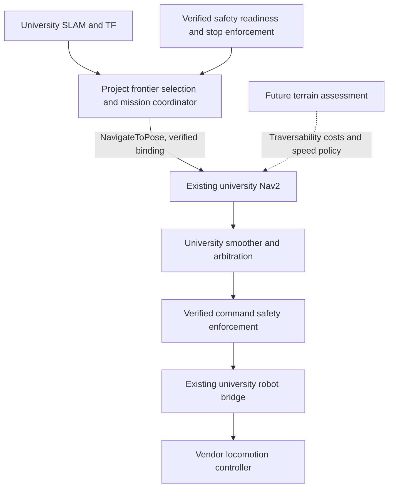

# University stack reuse audit — 2026-11-13

## Status and evidence boundary

**Audit complete for the available project source; refactor pending prerequisites.**
No runtime code, launch behavior, dependencies, or existing tests were changed.
No code was deleted. No university packages were modified. No ROS nodes,
robot services, Auto Mode, or physical movement were started.

This environment is a filesystem snapshot, not the earlier onboard ROS environment:

- The workspace root is not recognized as a Git repository. Its `.git` directory
  is empty; the project has no separate Git repository. The required preservation
  branch could not be created. No replacement repository was initialized.
- `/home/user/ros2_ws`, `lite3_launcher` source, and the university installation
  are unavailable. ROS 2 and `/opt/ros` are also absent.
- The supplied Lab 4, Lab 5, and `file_autonomy_stack.md` attachment paths do not
  exist in this snapshot. Their contents and the referenced line were not read.
- The [earlier university audit](university_motion_path_review.md) is available.
  It reports a university Nav2/smoother/mux chain, but also unresolved outbound
  bridge access. These are historical observations, not current verification.
- The pinned [vendor bridge source](../vendor/Lite3_ROS/src/transfer/src/Jetson2Motion.cpp)
  and [launch](../vendor/Lite3_ROS/src/transfer/launch/transfer_launch.py) are
  available and were inspected. They do not establish the installed university
  bridge's configuration or current behavior.

The user's requirements to inspect actual university source and preserve the
original in Git therefore prevent a runtime refactor or retirement in this
environment. The design below is a proposal, not an implemented architecture.

## Component decisions

| Component | Finding | Decision after replacement verification |
| --- | --- | --- |
| [Frontier selection](../lite3_locomotion/frontiers.py) | Bounded free-space search, frontier clustering, clearance, ranking, autonomous destination selection | Retain: project exploration functionality; no available evidence that the university supplies it |
| [Coordinator](../lite3_locomotion/exploration_coordinator.py) | Mission start/stop, one goal at a time, failure cooldown, goal budget/deadline, session radius, stale map/TF checks, late-accept cancellation | Retain and adapt its external interfaces |
| [Preview](../lite3_locomotion/exploration_preview.py) | Marker-only goal inspection and occupancy-grid conversion shared with coordinator | Retain as optional development tool; not a required runtime node |
| [Autonomy launch](../launch/autonomy.launch.py) | Starts planner, controller, BT navigator, lifecycle manager, adapter, coordinator | Replace with project coordinator-only integration launch; keep the old stack available until tests pass |
| [Nav2 configuration](../config/nav2_frontiers.yaml) and behavior-tree XML | Standard Navfn and Regulated Pure Pursuit plugins; no custom planner/controller algorithm | Retire duplicate configuration and server launches if university behavior is verified; review recovery behaviors as well as normal navigation |
| [Guard adapter](../lite3_locomotion/guarded_adapter.py) | Velocity validation, scan/TF health, software stop, bounds, sender session and graph checks | Preserve safety requirements; do not simply delete or remap it. Existing handshake is incompatible with the inspected vendor source |
| [Movement guard](../lite3_locomotion/movement_guard.py) and [command policy](../lite3_locomotion/command_policy.py) | Deterministic bounds, freshness and stop policies | Retain useful policies/tests; decide their enforcement point after auditing university command routing |
| [Motion sender](../lite3_locomotion/motion_sender.py) | Custom UDP transport plus independent session/watchdog logic | Candidate for retirement in favor of existing bridge; do not lose watchdog behavior without a verified replacement |
| [Mission CLI](../lite3_locomotion/autonomy_control.py) | Automatically arms project adapter before starting exploration | Adapt to mission-only control after defining external safety readiness; no automatic university mode changes |
| [Test controller](../lite3_locomotion/controller_node.py) | Fixed-topic, non-actuating command-policy harness | Optional test fixture, not part of deployed exploration |
| [Bounded sequencer](../lite3_locomotion/bounded_test.py), [pulse](../lite3_locomotion/commissioning_pulse.py), [protocol preview](../lite3_locomotion/protocol_preview.py) | Commissioning/transport experiments | Preserve as historical or offline tools initially; exclude from simplified runtime and later reassess |
| Vendor, review and recovery directories | Reference source and deployment candidates | Retain as evidence; do not build, deploy, or modify university code |
| Existing integration runners | Start project Nav2/test transport in isolated test environments | Keep as regression fixtures until replacement action-contract tests pass; not the future production architecture |

## NavigateToPose integration requirements

The existing coordinator constructs `nav2_msgs/action/NavigateToPose.Goal`, sets
a `map`-frame pose and unit yaw quaternion, leaves `behavior_tree` at its default,
and handles acceptance, result status and cancellation. Reusing this standard
client is plausible; the university endpoint is **not yet verified**.

Current hard-coded dependencies that prevent a blind endpoint substitution:

- Action: `/lite3_autonomy/navigate_to_pose`.
- Lifecycle services: `/lite3_autonomy/{controller_server,planner_server,bt_navigator}/get_state`.
- Map `/map` with reliable/transient-local QoS; TF `map -> base_link`.
- Fresh `/lite3_locomotion/autonomy_enabled` guard heartbeat and project stop service.
- The CLI starts by arming the project guard. The guard expects the project's
  exact publisher/subscriber identities and custom sender session acknowledgement.

Inspect the university top-level and included navigation/SLAM launches, namespace
and remaps, parameter YAML, BT XML, composition/lifecycle settings, smoother,
mux and installed bridge. Record source paths and version/commit provenance.
On an already running authorized stack, use read-only, non-daemon graph/interface
inspection to confirm the resolved action name/type, action owner, lifecycle
services/states, map QoS/frame, TF frames, odometry, scans and velocity routing.
Do not launch the university stack to obtain this evidence during development.
Check the installed ROS/Nav2 version and actual action definition, not just names.

Then make validated action, lifecycle and frame/topic bindings explicit in a
project integration configuration. Keep start explicit and fail closed on missing
or stale readiness. Preserve epoch-based cancellation of late goal acceptance,
but add cancellation-result/timeout handling: requesting cancellation does not
prove navigation or physical motion has stopped.

## Motion bridge and safety

The inspected vendor source subscribes to relative `cmd_vel` and
`cmd_vel_corrected` using `geometry_msgs/msg/Twist`, plus simple/complex command
messages. Its default target address/port are source defaults only. Its launch
also starts app and sensor-checker processes; it must not be started for this
audit. The source has no equivalent of the project's ready/session handshake
or independent command-expiry policy.

The historical university report describes:

```text
Nav2 -> cmd_vel_nav -> smoother -> nav_cmd_vel -> mux -> /cmd_vel -> vendor bridge
                                       joystick --^
```

Confirm this against actual source and installed runtime before reuse. Do not
connect the dry-run topic to `/cmd_vel`, spoof sender identities, or assume a
mux timeout replaces a watchdog. A mission supervisor can cancel goals but cannot
enforce velocity stops downstream of Nav2. Verify command expiry, link/process
failure behavior, other inputs and independent stop controls before removing
the guard or sender safety mechanisms.

Development must use a mock action server in a loopback-only test domain, with
no bridge, university service startup, or physical command publishers. Sending
goals to a real university Nav2 server can cause movement even if this package
publishes no velocities. A `dry-run` label alone is insufficient.

## Proposed minimal architecture (not implemented)



Project runtime target: one mission coordinator, with frontier logic in-process.
Only retain a separate safety process if the audited university path cannot
enforce the required policies. Preview and CLI are optional tools. Safety
enforcement placement and interfaces remain unresolved; the diagram does not
assert that the university already supplies them.

## Ordered migration and test plan

1. Restore the actual Git checkout and university source/lab references. Record
   working-tree status; preserve tracked and intended untracked source, excluding
   generated logs/builds, in a baseline commit and named preservation branch.
   Verify the branch contains the original before editing runtime code.
2. Complete the interface evidence table above. Keep university packages unchanged.
3. Add external integration configuration and a coordinator-only launch. It must
   start no Nav2 server, lifecycle manager, bridge, velocity sender or robot mode
   service; development configuration must remain isolated and non-actuating.
4. Test against a mock NavigateToPose server: explicit start, pose/frame/type,
   acceptance/rejection, success/abort, exceptions, delayed acceptance after stop,
   cancellation acknowledgement/failure, repeated stop, goal deadline/budget,
   failure cooldown, stale map/TF/readiness and unavailable/inactive server.
5. Retain frontier, guard and command-policy unit tests. Add launch assertions
   for the minimal node set and no physical publishers. Adapt CLI tests so no
   transport or robot mode is armed. Do not weaken existing safety tests merely
   to accommodate the external bridge.
6. Run isolated ROS integration with synthetic map/TF and a mock server, then
   verify the university configuration in a proven non-actuating environment.
   Physical robot validation is outside this development task.
7. Only after replacement verification and passing tests, retire duplicate Nav2
   launches/configuration/dependencies and obsolete sender entry points. Record
   each removal and replacement test; retain historical code on the baseline
   branch. Rewrite README and architecture docs to describe the verified result.

## Tests performed in this snapshot

- Ordinary pytest suite: **281 passed, 23 skipped, 1 failed** in 0.34 s. The
  failure was `test_real_loopback_datagrams_match_vendor_abi`: socket creation
  was denied by sandbox policy, before any datagram could be sent.
- Approved focused rerun of that test: **1 passed** in 0.01 s. It tests packet
  framing through localhost UDP only; no physical command destination is used.
- Aggregate: **282 tests passed across the two invocations; 23 opt-in tests
  skipped**. No claim is made that the full suite passed in a single run.
- No ROS integration/build or university action compatibility verification was
  possible because ROS and university packages are absent. Existing stored logs
  are historical evidence and were not counted as new validation.

## Changes in this audit

Added this report and a README status link. Retained all implementation,
configuration, launches and tests unchanged. Removed nothing. No preservation
branch or refactor is claimed complete.

## Autonomous terrain traversal still required

The existing exploration logic is two-dimensional occupancy-grid selection,
not terrain-aware locomotion. Future work includes calibrated LiDAR/IMU terrain
assessment (slope, roughness, steps and drop-offs), uncertainty handling,
traversability costs integrated through supported university Nav2 interfaces,
terrain-dependent speed/route policies, and verified vendor gait/capability
interfaces if needed. Validate perception and policies offline and in simulation
before separately authorized physical traversal. The project should consume
the vendor locomotion controller rather than duplicate joint control without
a demonstrated requirement.
